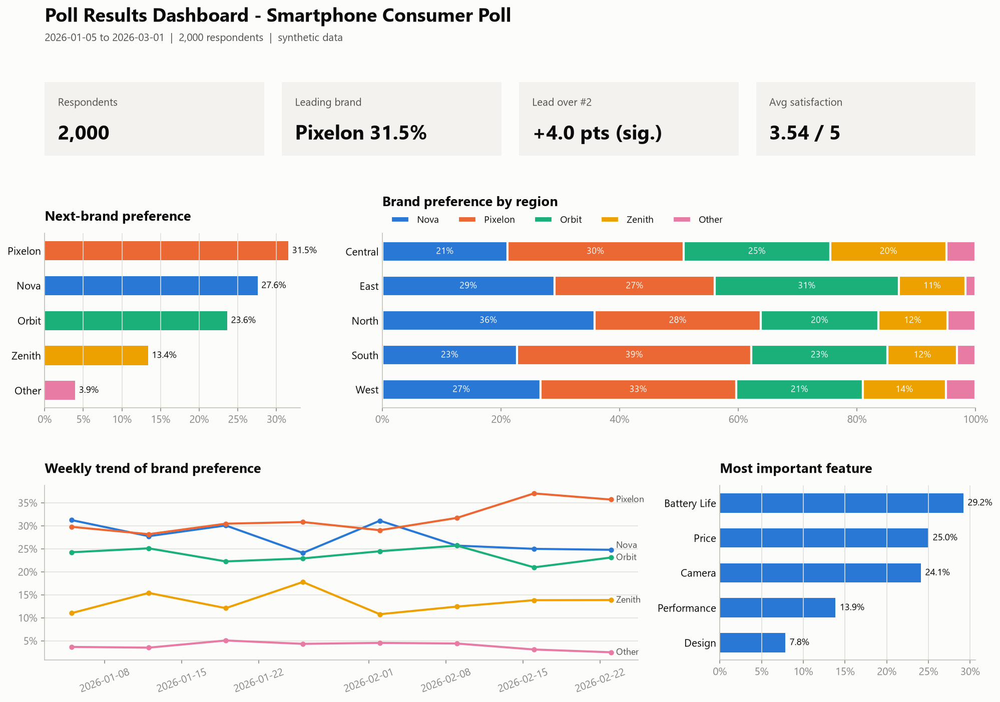
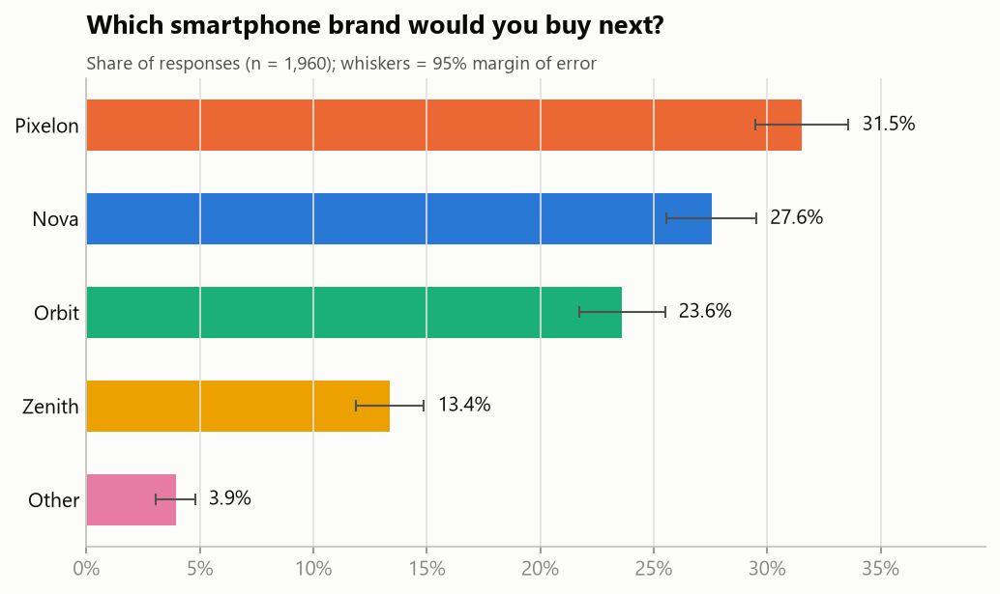
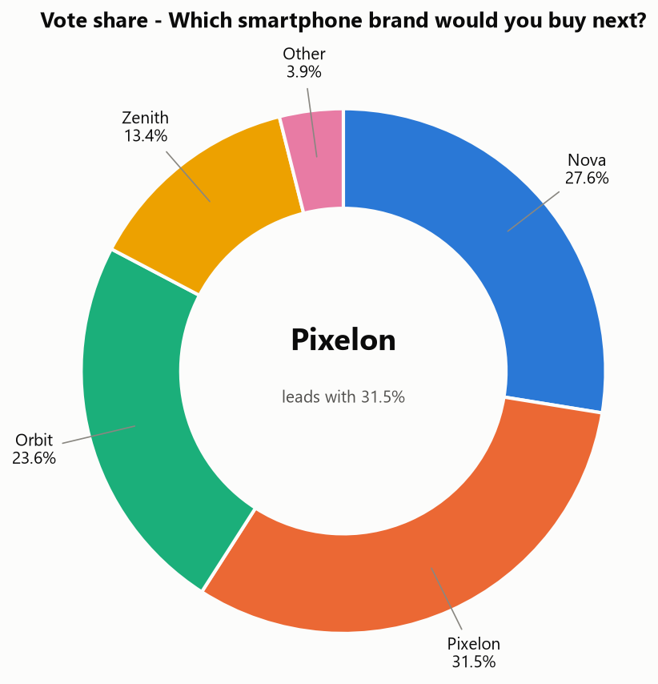
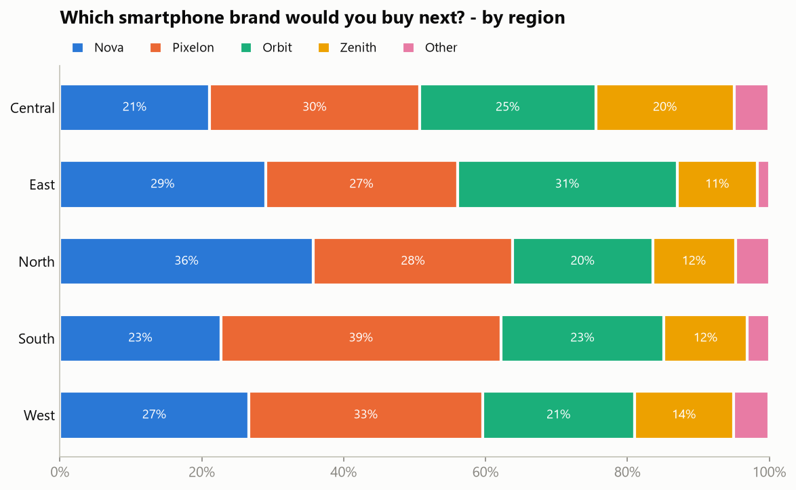
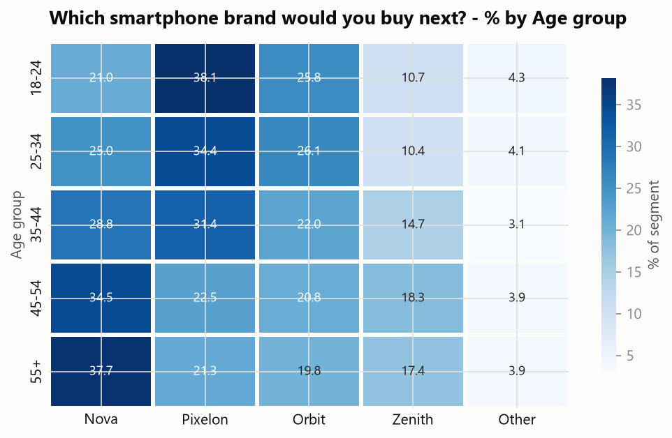
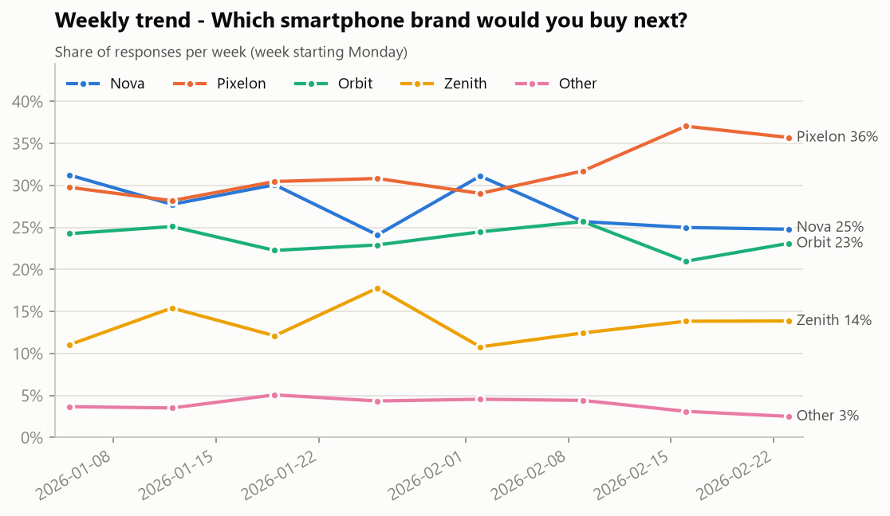
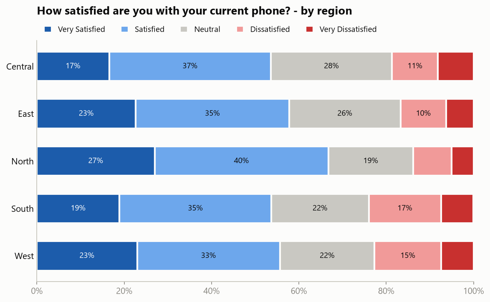
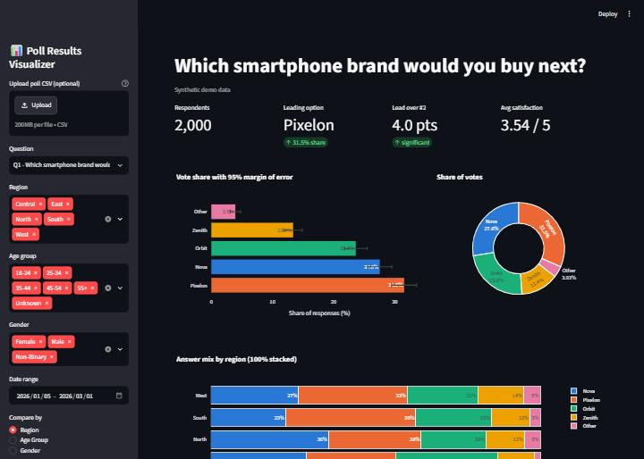

# 📊 Poll Results Visualizer

> An end-to-end survey analytics project: it takes raw poll responses (synthetic data, a CSV, or a Google Forms export), cleans them, measures vote share **with margins of error**, compares regions and demographics, tracks trends over time, and produces charts, an interactive dashboard and an auto-written insights report.

   



---

## 🧩 Problem

Organizations run polls all the time: election polls, customer feedback, employee satisfaction, product preference, event feedback. Raw exports are messy, though. They contain duplicate submissions, skipped questions, inconsistent spellings, and thousands of rows that nobody can read. Decision-makers need three things:

1. **Who or what is winning, and by how much?** (and is that lead real, or just noise?)
2. **Where and among whom** do opinions differ? (region, age, gender)
3. **What is changing over time**, and what should we do about it?

## 💡 Solution

A modular Python pipeline:

```
poll data ──► cleaning ──► analysis ──► visualization ──► insights ──► decisions
 (CSV / Google Form /       (dedupe,     (shares, MoE,     (bar, pie,     (auto-written
  synthetic generator)      standardize)  segments, trend,  stacked,       Markdown report
                                          chi-square)       heatmap,       + Streamlit
                                                            trend)         dashboard)
```

## ✨ Features

| Area | What it does |
|---|---|
| **Data input** | Realistic synthetic poll generator (seeded, reproducible) **or** your own CSV. Google Forms "wide" exports are auto-converted to tidy long format |
| **Cleaning** | Trims and standardizes text, maps answers to official options, removes blank/invalid answers and duplicate submissions, fills missing demographics with `Unknown`, parses dates, and writes a full **cleaning log** |
| **Analysis** | Vote count, % share, rank, **95% margin of error**, leader vs runner-up **significance test**, region/age/gender breakdowns, weekly trend, Likert satisfaction score and net satisfaction, **chi-square test + Cramér's V** |
| **Visualization** | 12 report-ready PNG charts: bar with error bars, donut, 100% stacked bars, heatmaps, weekly trend, net-satisfaction bars, one-page dashboard |
| **Dashboard** | Streamlit app with filters (question, region, age, gender, date range), KPIs, interactive Plotly charts, CSV upload and download |
| **Insights** | Plain-English findings and recommendations generated from the data → `outputs/insights_report.md` |

## 🛠 Tech stack

- **Python 3.10+**
- **Pandas, NumPy**: data wrangling and aggregation
- **SciPy**: chi-square test of independence
- **Matplotlib, Seaborn**: static charts
- **Plotly + Streamlit**: interactive dashboard
- **Jupyter**: EDA notebook

## 📁 Project structure

```
Poll-Results-Visualizer/
├── data/
│   ├── raw/                  # poll_responses_raw.csv, sample_google_form_export.csv
│   └── processed/            # poll_responses_clean.csv
├── notebooks/
│   └── poll_analysis_eda.ipynb
├── src/
│   ├── config.py             # questions, options, demographics, paths
│   ├── data_generator.py     # synthetic poll simulation
│   ├── data_loader.py        # CSV / Google Form loader
│   ├── data_cleaning.py      # cleaning + cleaning log
│   ├── analysis.py           # shares, MoE, segments, trend, chi-square
│   ├── visualization.py      # Matplotlib/Seaborn charts
│   └── insights.py           # auto-generated findings + report
├── dashboard/
│   └── app.py                # Streamlit dashboard
├── outputs/                  # summary CSV tables + insights_report.md
├── images/                   # all generated charts (PNG)
├── docs/
│   └── PROJECT_GUIDE.md      # full guide: theory, simulation, interview prep
├── main.py                   # runs the whole pipeline
├── requirements.txt
└── README.md
```

## 🚀 How to run

```bash
# 1. Clone
git clone https://github.com/Nischay2008/Poll-Results-Visualizer.git
cd Poll-Results-Visualizer

# 2. Virtual environment
python -m venv .venv
# Windows:      .venv\Scripts\activate
# Mac / Linux:  source .venv/bin/activate

# 3. Install
pip install -r requirements.txt

# 4. Run the full pipeline (generates synthetic data → charts → report)
python main.py

# 5. Launch the interactive dashboard
streamlit run dashboard/app.py
```

**Options**

```bash
python main.py --respondents 5000          # bigger synthetic poll
python main.py --seed 7                     # a different random poll
python main.py --input data/raw/sample_google_form_export.csv   # your own / Google Form CSV
```

## 📈 Results (default run: 2,000 synthetic respondents, 8 weeks)

| Option | Votes | Share | 95% MoE |
|---|---:|---:|---:|
| **Pixelon** | 618 | **31.5%** | ±2.1 |
| Nova | 540 | 27.6% | ±2.0 |
| Orbit | 463 | 23.6% | ±1.9 |
| Zenith | 262 | 13.4% | ±1.5 |
| Other | 77 | 3.9% | ±0.9 |

**Key insights (auto-generated):**

- **Pixelon leads** with 31.5% vs Nova at 27.6%. The 4.0-point lead is **statistically significant** (MoE of the gap ±3.4 pts).
- Pixelon does **not** win everywhere: **Nova leads in the North** (35.8%) and **Orbit leads in the East** (31.0%).
- A **generation gap**: 18–44 year-olds prefer Pixelon, while 45+ prefer Nova.
- **Momentum:** Pixelon gained about 7 pts between the first two and last two weeks, while Nova lost about 5 pts.
- Satisfaction averages **3.54/5**. The **South** has the lowest net satisfaction (+29.7 vs +52.9 in the North).
- **Battery life** is the #1 purchase driver; 18–24s prioritize the **camera**.
- Chi-square tests confirm that brand choice depends on **region** and **age** (p < 0.001) but **not on gender** (p = 0.20).

Full report: [`outputs/insights_report.md`](outputs/insights_report.md)

## 🖼 Screenshots

| Vote share (with margin of error) | Donut chart |
|---|---|
|  |  |

| By region | By age group |
|---|---|
|  |  |

| Weekly trend | Satisfaction by region |
|---|---|
|  |  |

Interactive dashboard (`streamlit run dashboard/app.py`):



## 🔄 Use it for your own poll

1. Export your Google Form responses as CSV (Responses → ⋮ → Download responses).
2. Make sure demographic columns are named like `Region`, `Age Group`, `Gender` (other names are listed in `src/data_loader.py`).
3. Add your questions and options to `QUESTIONS` in `src/config.py` so answers are validated.
4. Run `python main.py --input path/to/your_export.csv`.

## 🔮 Future improvements

Live polling via the Google Sheets API, sentiment analysis on open-ended answers, survey weighting (raking) to match census demographics, a Power BI version, and deployment on Streamlit Community Cloud.

## ⚠️ Disclaimer

The default dataset is **synthetic**: it is generated by `src/data_generator.py` with known, planted patterns. Brand names are fictional.

## 👤 Author

**Your Name**: [LinkedIn](https://linkedin.com/in/your-profile) · [GitHub](https://github.com/Nischay2008)
