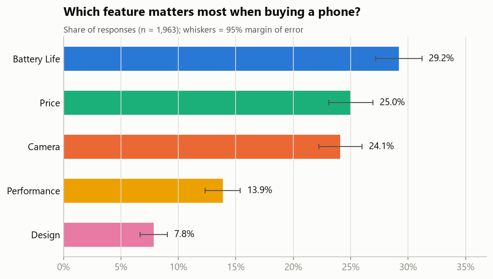
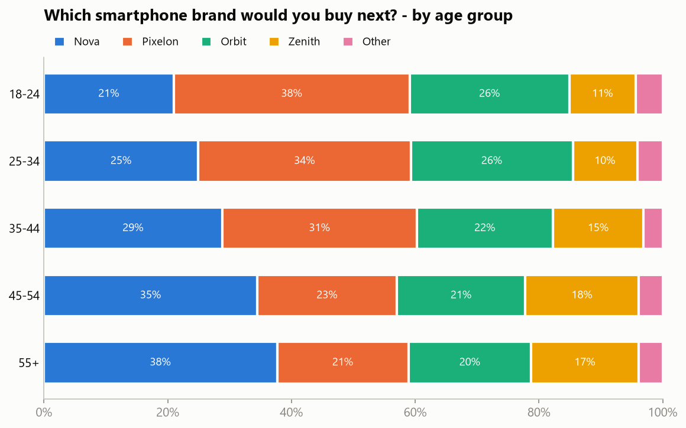
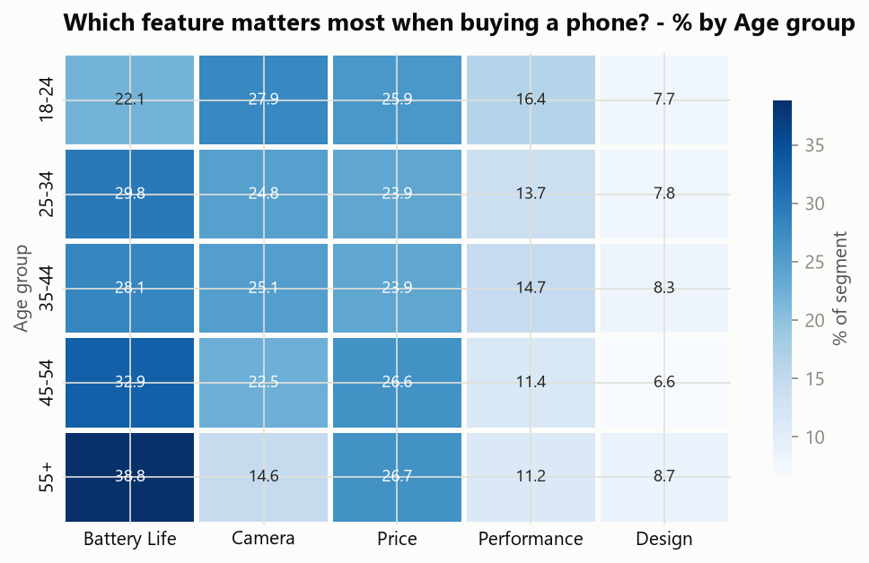
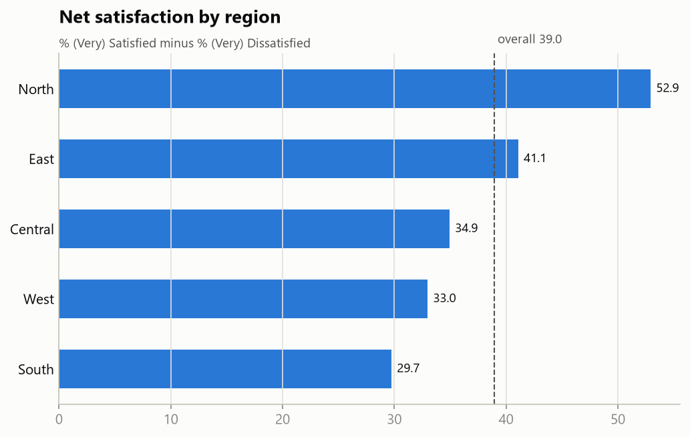
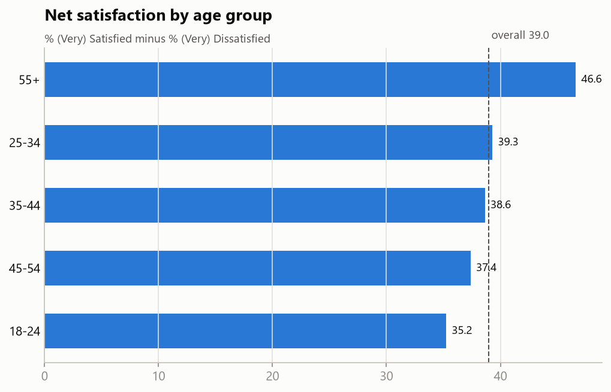

# Poll Results - Insights Report
_Generated 2026-10-16 12:49 by Poll Results Visualizer_

## 1. Dataset summary
- Respondents: **2,000**
- Responses (answers): **5,882**
- Questions: 3  |  Regions: 5
- Polling window: 2026-01-05 to 2026-03-01

## 2. Data cleaning log
| Step | Rows |
|---|---:|
| rows in | 6,120 |
| removed missing answer | 88 |
| removed invalid answer | 30 |
| removed duplicates | 120 |
| filled unknown region | 0 |
| filled unknown age group | 60 |
| filled unknown gender | 0 |
| unparseable dates | 0 |
| rows out | 5,882 |
| respondents | 2,000 |

## 3. Headline result - Which smartphone brand would you buy next?
| Option | Votes | Share | 95% MoE | Rank |
|---|---:|---:|---:|---:|
| Pixelon | 618 | 31.5% | +/-2.1 | 1 |
| Nova | 540 | 27.6% | +/-2.0 | 2 |
| Orbit | 463 | 23.6% | +/-1.9 | 3 |
| Zenith | 262 | 13.4% | +/-1.5 | 4 |
| Other | 77 | 3.9% | +/-0.9 | 5 |

## 4. Key insights
1. **Pixelon** is the most preferred next brand with 31.5%, ahead of Nova (27.6%). The 4.0-point gap is a statistically significant lead (95% MoE of the gap: +/-3.4 pts, n = 1,960).
2. Regional winners - Central: Pixelon (29.7%), East: Orbit (31.0%), North: Nova (35.8%), South: Pixelon (39.5%), West: Pixelon (33.0%).
3. Pixelon does NOT win everywhere: Orbit leads in East; Nova leads in North. Region-specific campaigns are recommended there.
4. Pixelon is strongest in South (39.5%) and weakest in East (27.0%) - a 12.4-point regional spread.
5. By age group the leader is: 18-24 -> Pixelon (38.1%), 25-34 -> Pixelon (34.4%), 35-44 -> Pixelon (31.4%), 45-54 -> Nova (34.5%), 55+ -> Nova (37.7%).
6. Momentum: Pixelon gained +7.4 pts from the first two weeks to the last two weeks, while Nova moved -4.6 pts.
7. Average satisfaction is 3.54/5; 58.0% are satisfied vs 19.0% dissatisfied. Highest net satisfaction: North (+52.9); lowest: South (+29.7).
8. Top buying factor overall: Battery Life (29.2%), then Price (25.0%). Youngest group (18-24) prioritises Camera; 55+ prioritises Battery Life.
9. Chi-square test: the answer to Q1 DOES depend on region (p = 3.87e-08, Cramer's V = 0.09, small effect).
10. Chi-square test: the answer to Q1 DOES depend on age group (p = 1.37e-07, Cramer's V = 0.09, small effect).
11. Chi-square test: the answer to Q3 DOES depend on age group (p = 0.00628, Cramer's V = 0.07, small effect).
12. Chi-square test: the answer to Q1 does not clearly depend on gender (p = 0.203, Cramer's V = 0.05, negligible effect).

## 5. Recommendations
- Lead marketing messages with **battery life** and **price**, the two biggest purchase drivers.
- For Pixelon: run targeted campaigns in East, North, where a competitor is preferred.
- Investigate low satisfaction in South (follow-up survey or open-ended feedback).
- Re-run the poll monthly and watch the weekly trend chart for shifts in momentum.

## 6. Charts

> Note: data is synthetic and generated for portfolio/demo purposes.